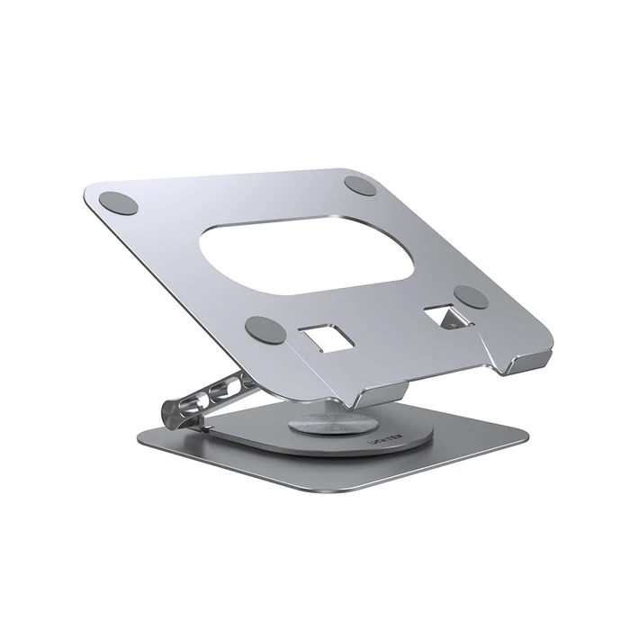

    

# hello 👋 i'm shadrackovsky timothy john, i am an aspiring young **ai / ml** and **software engineer** from tanzania, doing web applications development, machine learning, and building systems around frontier models.

# i didn't grow up with a computer in my room until my lovely grandmother in heaven bought me my first laptop (second-hand old elitebook) when i joined college.

# i've built this journey fueled by tiring, long nights, insatiable curiosity, and a genuine love for understanding how things work and connected since i was a young boy.

# i'm obsessed with karpathy, ilya, lecun, andrew ng, bengio, radford, ian goodfellow, alex krizhevsky, georgi gerganov.

# 🛠 technologies i use everyday.

# 🧠 roadmap i'm focusing right now.

| field | what i'm mastering right now |
|------|---------------------|
| **genai & llms** | fine-tuning (lora/qlora), rag systems, chroma vector db, hugging face |
| **python & data** | fastapi, pandas, numpy, pytorch, ai models and large dataset trainings |
| **data engineering** | sql, data cleaning, pipelining, api integration |
| **cloud & devops** | docker, kurbenetes, git |
| **frontend** | react, next, vite, tailwind css, shadcn-ui |
| **backend** | supabase, django, springboot |
| **computational finance** | quantitative modeling, algorithmic trading, risk analysis, portfolio optimization |

# 💻 my learning framework.

# i'm a self taught software engineer, i watch tons of youtube or pirated tutorials and practise, practise to build new skills.

# 🎮 my desk  gadgets.

<table>
<tr>
<td align="center" width="14%"> <b>m3 macbook pro</b> 14" · 1tb</td>
<td align="center" width="14%"> <b>monitor lightbar</b> lymax l1 plus</td>
<td align="center" width="14%"> <b>vertical stand</b> vaydeer dock</td>
<td align="center" width="14%"> <b>360° stand</b> multi-angle</td>
<td align="center" width="14%"> <b>anti-blue ray</b> eye protection</td>
<td align="center" width="14%"> <b>neckband</b> lenovo he05x</td>
<td align="center" width="14%"> <b>chessboard</b> focus and strategic breaks</td>
</tr>
<tr>
<td align="center" width="14%"> <b>microfiber</b> screen cleaning</td>
<td align="center" width="14%"> <b>desk organizer</b> mesh holder</td>
<td align="center" width="14%"> <b>logitech g213</b> keyboard</td>
<td align="center" width="14%"> <b>34" curved</b> uhd monitor</td>
<td align="center" width="14%"> <b>wooden shelf</b> desk shelf</td>
<td align="center" width="14%"> <b>the broken wings</b> kahlil gibran</td>
<td align="center" width="14%"> <b>island</b> aldous huxley</td>
<td align="center" width="14%"> <b>rubber duck</b> debugging</td>
</tr>
</table>

# 🤝 currently looking for.

# open for freelance contracts in ai/ml and full-stack, open-source ai collaborations, remote engineering roles.

# 🎸 my recently playing music.

  

# 𖡎 see malaika my ai companion.

    

# 𖡎 see swahili-gpt pre-trained model trained from scratch.

    

# 𖡎 we're bootstrapping swahili-lm with deepseek api by wrapping with prompt engineering tuned for tanzanian context.

    

# 𖡎 if you wanna build chat agents, you don't need to start from scratch. try bruno and re-use the component in your app.

    

    
    &nbsp;&nbsp;
    

# 𖡎 shadrackovsky is also a co-creator of smarbo digital. smarbo digital is a web application that helps you track invitations, contributions and attendance for your event, in one simple dashboard.

    

# 𖡎 see my business antera.

    

# 𖡎 shadrackovsky loves coffee.

    

# 🚀 hire shadrackovsky today.

# mwalyangashadrack@gmail.com